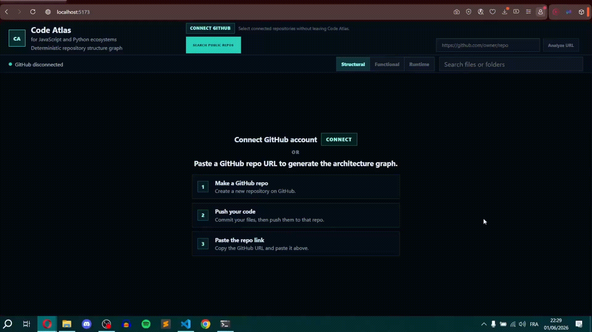

# Code Atlas

**Explore any GitHub codebase as an interactive graph, one click at a time.**

[](https://code-atlas.up.railway.app)


AI made code generation cheap. Understanding remained expensive. Code Atlas reduces that understanding cost: point it at a GitHub repository and it builds an interactive dependency graph of the folders, files and imports, using static AST analysis. No LLMs, no embeddings, so the same repo always produces the same graph.

The graph starts at the repository root and shows only what you ask for. You build your own mental map by drilling into folders and following imports, instead of being handed a diagram you cannot trust.



## Try it

Open [code-atlas.up.railway.app](https://code-atlas.up.railway.app) and either:

- search for a public repository,
- paste any public GitHub URL, or
- connect your GitHub account and pick one of your own repos.

Analysis time scales with repo size: about 15 seconds for Code Atlas itself, about 4 minutes for `facebook/react`.

## What you can do

- **Navigate the graph**: click into folders to reveal only the current level and its neighbors. Files with many inbound imports are load-bearing, files with none are safe leaves.
- **Inspect a file**: see lines, functions, imports, imported-by, and a plain-language role (entry point, coordinator, shared utility, leaf). Click a dependency to recenter the graph on it.
- **Follow connections**: hover the left dot of a file to reveal who imports it, the right dot to reveal what it imports.
- **Read source with context**: split view with a structured outline (imports, functions, variables). Variables are sorted by how widely they are referenced.
- **Explore the timeline**: pick a commit to see which files changed and where complexity has been accumulating.

Supported import analysis: JavaScript / TypeScript and Python.

## Run it locally

You need Node.js and npm.

```sh
git clone https://github.com/Seifpetit/code-atlas.git
cd code-atlas
cd backend && npm install
cd ../frontend && npm install
```

Start the backend (http://localhost:4000) in one terminal:

```sh
cd backend
npm run dev
```

Start the frontend in a second terminal, then open http://localhost:5173:

```sh
cd frontend
npm run dev
```

Public repositories work without any further setup. Paste a URL such as `https://github.com/vitejs/vite`.

To enable "connect your GitHub account" locally, create a GitHub OAuth app with the callback URL `http://localhost:4000/auth/github/callback`, then:

```sh
cd backend
cp .env.example .env
```

and fill in `.env`:

```sh
GITHUB_CLIENT_ID=your_github_client_id
GITHUB_CLIENT_SECRET=your_github_client_secret
GITHUB_OAUTH_CALLBACK_URL=http://localhost:4000/auth/github/callback
FRONTEND_URL=http://localhost:5173
```

Check that both parts build:

```sh
cd backend && npm run build
cd ../frontend && npm run build
```

A `Dockerfile` is included (`npm run docker:build` at the root), and the live site is deployed on Railway.

## How it works

Each request clones the repository, extracts its structure and imports with AST parsing, builds the graph, then discards the clone. No repository data is stored.

- `backend/src/`: Express API, repo cloning, JS/TS and Python import extraction, graph assembly, git history and diffs, GitHub OAuth.
- `frontend/src/`: React and React Flow canvas, layout engine, source inspector, runtime replay, commit timeline.

Deeper docs:

- [Product setup, deployment and API](docs/README.md)
- [Vocabulary](docs/VOCABULARY.md): canonical product and interaction terms
- [Decisions](docs/DECISIONS.md): accepted, paused and superseded product decisions
- [UI layout](docs/UI_LAYOUT.md): dimensions, positions and color roles
- [Workflow](docs/WORKFLOW.md) and [CONTEXT.md](CONTEXT.md): how the project is developed

## Known issues

- Hover tracing on connection handles was recently fixed in code but still needs visual verification in the browser. Details in [bugs.md](bugs.md) and [docs/BUGS.md](docs/BUGS.md).
- Import analysis covers JS/TS and Python only; other languages show structure but no import edges.
- Very large repositories take minutes to analyze.

## License

No license file is present in the repository yet.
